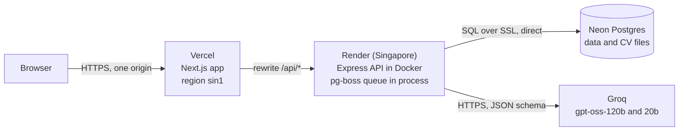
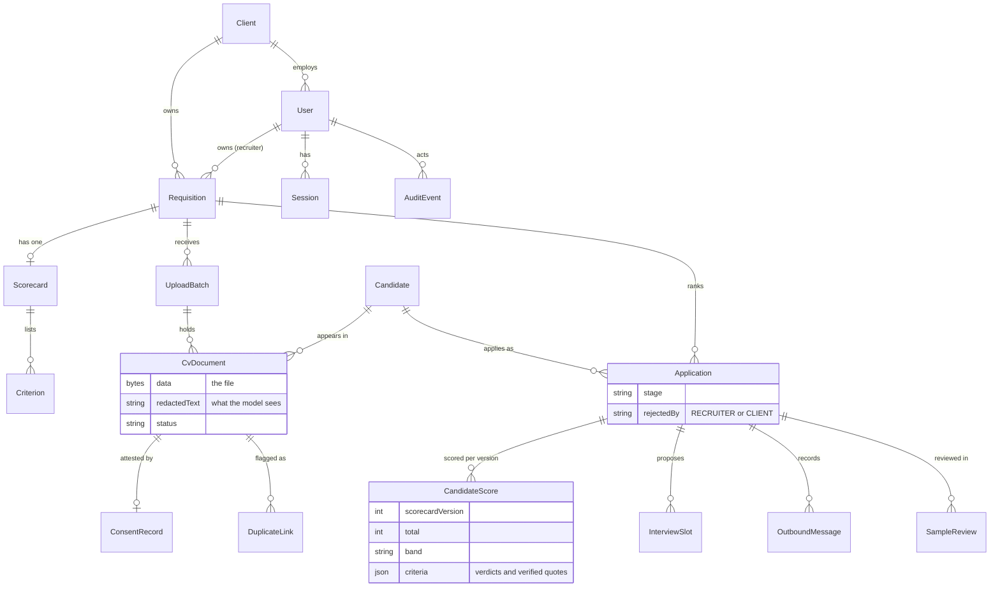
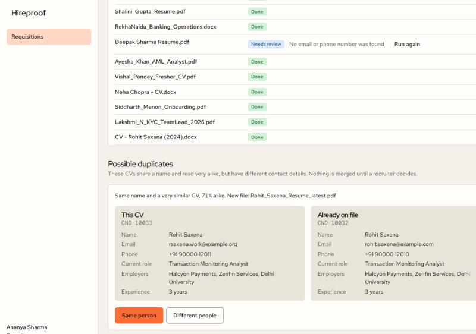
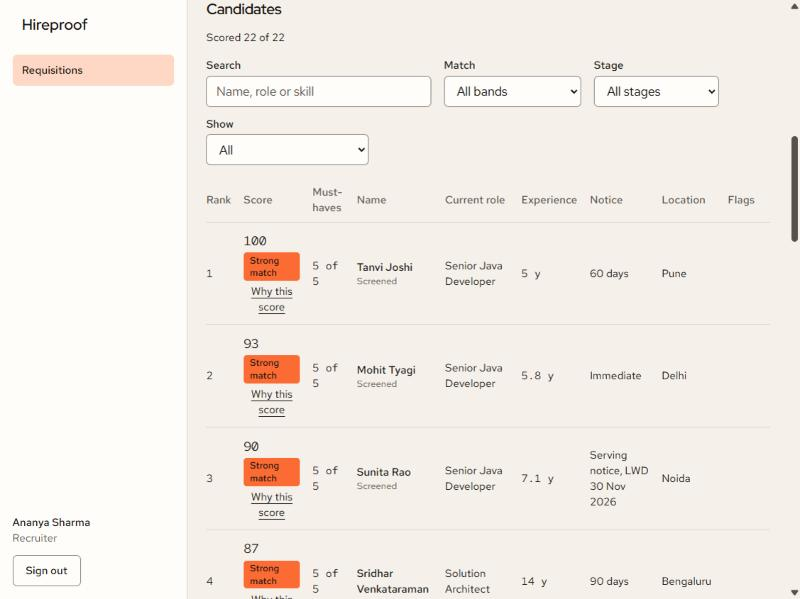
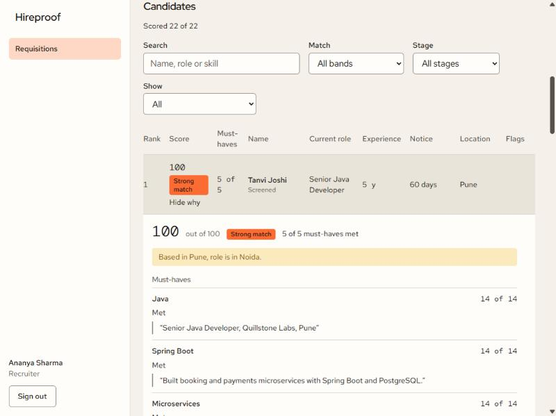
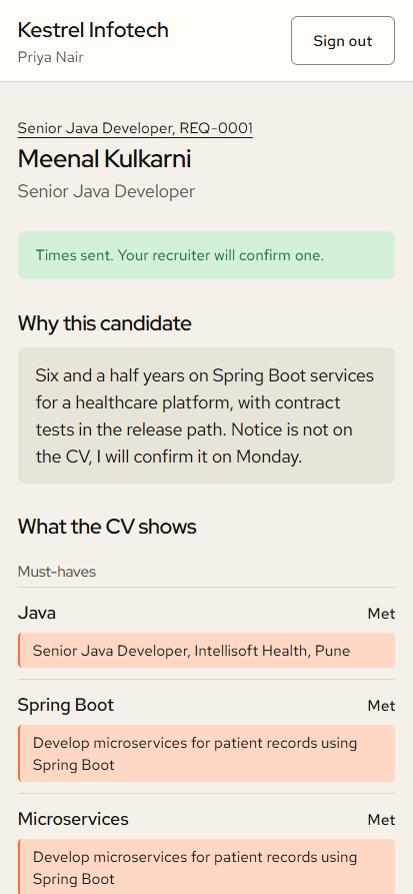
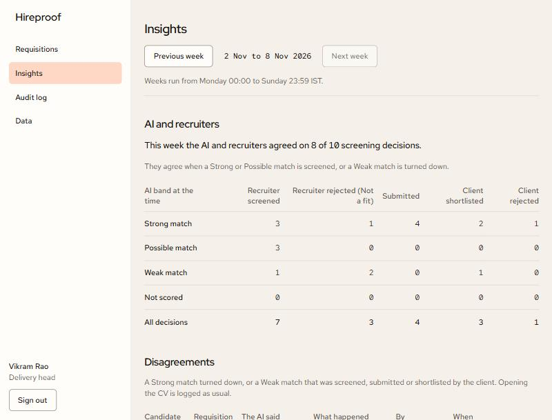

# Hireproof: technical design

Live app: {{WEB_URL}} | API health: {{API_URL}}/api/health | Source: github.com/thisisfaizanali/hireproof

## 1. Summary

Hireproof is a screening tool for a staffing firm that places people with client companies. A recruiter opens a requisition, the AI reads the job description into a scorecard, and the recruiter confirms it. The recruiter then drops in a batch of CVs (PDF, DOCX, scans). Each CV is parsed, checked for duplicates and scored against the scorecard. Every point in a score is backed by a sentence quoted from the CV and verified in code, so a recruiter can see why a candidate ranks where they do and a client can see it too.

There are three users, and each gets a different view of the same data.

| User                  | What they do                                                                                                                                                             | What they never get                                                               |
| --------------------- | ------------------------------------------------------------------------------------------------------------------------------------------------------------------------ | --------------------------------------------------------------------------------- |
| Recruiter             | Creates requisitions, confirms scorecards, uploads CVs, reads ranked candidates and their evidence, screens, submits to the client, confirms interview times             | Insights, the audit log and candidate erasure, which are for the delivery head    |
| Client hiring manager | Reads submitted candidates on a phone, with evidence and a band, shortlists, rejects with a reason, proposes interview times                                             | Contact details, the 0 to 100 number, other clients' data, anything not submitted |
| Delivery head         | Reads everything, checks each week whether the AI and recruiters agree, reviews a sample of decisions, reads the audit log, erases candidates on request or at retention | Any change to requisitions, scores or stages                                      |

What is live at {{WEB_URL}}: the web app on Vercel, the API on Render, Postgres on Neon, and Groq as the model provider. The database holds three fictional client companies, five demo users, four requisitions made from four sample job descriptions, and about 45 sample CVs with scores, submissions, interview times and two weeks of decisions. Messages to candidates and clients are recorded but not sent (A5).

## 2. The problem as we read it

A staffing firm receives CVs in volume and in every shape: Word files, PDFs with a text layer, scans of printed pages, one-page freshers' CVs, three-page senior ones, tables, sidebars. Three things go wrong at that scale, and each one is a different kind of problem.

1. **Reading the pile.** Recruiters spend their time finding who is worth a call. Parsing has to cope with layout and spelling variety, and with the same person arriving twice under two file names.
2. **Trusting a score.** A number from an AI that nobody can check is a liability, with the recruiter and with the client. It also invites gaming: a CV can stuff keywords or address the model directly.
3. **Handling people's data.** CVs hold contact details, dates of birth, photographs and family details. A client should not receive any of it, the firm should be able to say why it holds a CV, and a person should be erasable completely.

On top of that sits a management question that a tool normally ignores: is the AI actually agreeing with the recruiters, or is it just adding a column nobody believes?

"Done" for us meant six checks that can be run, not a feature list.

- Every file in a batch reaches a final state (parsed, needs review, failed with a plain reason, or duplicate), including after a server restart.
- No score point exists without a quote that is found in the CV text.
- A client's API responses contain no email, no phone number, no total score, and nothing from another client.
- The delivery head can see, for any week, where AI and recruiters disagreed and can mark who was right.
- Erasing a candidate leaves no trace of their name, email or phone in any text column of any table.
- The whole thing deploys as three free services from the repository, and a script can check the result.

## 3. Assumptions

Each assumption is something we decided without being told. The last column says what we would change if it turns out wrong.

| #   | Assumption                                                                                                       | Why                                                                                                                                                                     | If it is wrong                                                                                                     |
| --- | ---------------------------------------------------------------------------------------------------------------- | ----------------------------------------------------------------------------------------------------------------------------------------------------------------------- | ------------------------------------------------------------------------------------------------------------------ |
| A1  | Scanned CVs are read by OCR for their first 3 pages only                                                         | OCR is the heaviest step in memory and time, and a CV's substance is on its first pages                                                                                 | Raise `OCR_PAGES`; time and memory per scan grow with it                                                           |
| A2  | A requisition has one owner. All recruiters can see and work on all requisitions                                 | A desk shares a pipeline; the owner column says who created it and powers a "mine" filter                                                                               | Add a per-requisition access list; every recruiter route already goes through one role check                       |
| A3  | CTC is in LPA (lakh rupees a year)                                                                               | The sample CVs and job descriptions all state pay that way, and the parser turns `₹14,50,000 p.a.` into 14.5                                                            | Add a currency and period to the profile, and convert before comparing                                             |
| A4  | Interview slots are proposals. A recruiter confirms one; no calendar is touched                                  | The client proposes, the firm owns the candidate relationship                                                                                                           | Integrate a calendar and make a confirmed slot an event                                                            |
| A5  | Messages to candidates and clients are mocked: stored as `MOCKED`, shown as "recorded, not sent"                 | Sending real email or WhatsApp from a demo is a risk with no benefit to the reviewer                                                                                    | Add a sender behind the same `OutboundMessage` row and a status `SENT`                                             |
| A6  | Consent is a recruiter's attestation at upload (applied for the role, or agreed to be considered), with a source | The firm collects CVs from portals, referrals and its own database, so the candidate is not in the room. We store who attested, when, the source and the notice version | A candidate-facing consent flow, and proof stored beside the attestation                                           |
| A7  | The weekly sample is 10 decisions, and agreement uses the AI's top-10 overlap per requisition                    | Ten is what one person reviews in a sitting; ten is also a usual shortlist length                                                                                       | `SAMPLE_SIZE` is one constant; the overlap window would follow the real shortlist size                             |
| A8  | A client sees the candidate's name and a CV text with contacts and personal fields removed, never contacts       | A client needs to recognise the person and must not be able to bypass the firm                                                                                          | Show initials only, or show a full CV after an offer stage                                                         |
| A9  | The demo holds about 45 CVs, and the limit of 500 CVs a batch is enforced                                        | The sample corpus is 45 files. The 500 limit is a validation rule in the API and the browser                                                                            | We have not run a 500 file batch (see section 15). A real batch needs the worker and storage changes in section 14 |
| A10 | The free hosting sleeps, so the first request after idle is slow                                                 | Render's free plan stops an idle service. Neon also pauses its compute                                                                                                  | A paid always-on instance removes it                                                                               |
| A11 | Notice period, CTC and location are flags beside the score, not points in it                                     | They are constraints a client can negotiate on, while skills and experience are what the CV proves                                                                      | A requisition setting that turns a flag into a filter                                                              |
| A12 | A client sees the evidence and a band label, not the 0 to 100 number                                             | A client who sees 78 against 74 will argue about two points that carry no meaning. The evidence is the thing to argue about                                             | Expose the number to the client with the formula                                                                   |
| A13 | The delivery head is read-only, except for sample reviews and erasing a candidate                                | They audit the work, so they should not be able to change what they audit. Erasure is a data-rights duty                                                                | Add a separate admin role for edits                                                                                |
| A14 | A client's rejection is final                                                                                    | The client owns the hiring decision; reversing it would let the firm override its customer                                                                              | An "ask to reconsider" action that creates a note, not a state change                                              |
| A15 | A scorecard that has not changed is not re-scored                                                                | Scoring costs tokens, and the free tier has a daily cap. A hash of the criteria and ranges detects "no change"                                                          | Re-score on every confirm and accept the cost                                                                      |

## 4. Architecture



The browser only ever talks to the Vercel address. Vercel forwards every `/api/*` request to the API, so the session cookie belongs to the web origin and is first party. That is also what keeps sign-in working in Safari on iPhones, which drops third-party cookies, and it removes the need for CORS. The API never approves a cross-origin preflight, which later matters for CSRF (section 10).

| Choice                                | Why                                                                                                                                                                                                                                                                               |
| ------------------------------------- | --------------------------------------------------------------------------------------------------------------------------------------------------------------------------------------------------------------------------------------------------------------------------------- |
| Next.js App Router on Vercel          | Server-rendered shells, role-based redirects through `proxy.ts` and route-group layouts, the `/api` rewrite built in. Designed at 375px first because clients read on phones                                                                                                      |
| Express and TypeScript API on Render  | A plain request and response model. The API is the only thing that touches data or the model, so every rule (roles, tenant scope, masking) lives in one place                                                                                                                     |
| Shared Zod package                    | One definition of every request and response shape for both apps, and the portal response types simply have no contact fields                                                                                                                                                     |
| Postgres on Neon, Prisma              | Relational data with real constraints. A `CHECK` ties a client hiring manager to a client and everyone else to none. Neon's free tier gives a managed database with no cost                                                                                                       |
| CV files stored in Postgres           | Erasing a candidate is one transaction that removes the file bytes together with every row about them. With object storage it would be two systems that can disagree, and a half-erased person is worse than a slow query. We would move to object storage at volume (section 14) |
| pg-boss queue inside the API process  | There is one service to deploy and no Redis. Jobs survive a restart because they live in Postgres, and CVs left mid-run are queued again when the API starts                                                                                                                      |
| Groq with an OpenAI-compatible client | Free tier, fast, supports strict `json_schema` output. The client is a thin wrapper, so swapping the provider is a base URL and a key                                                                                                                                             |
| Docker for the API                    | The OCR stack (`tesseract.js`, a canvas binary, English language data) is included, so it runs on Render with no system packages and no network fetch at run time                                                                                                                 |
| Session cookies in the database       | Logout and expiry take effect at once, and a leaked database does not yield usable cookies (section 10)                                                                                                                                                                           |

## 5. Data model



Three details carry most of the weight.

- **A candidate is a person, an application is a person for a requisition.** A candidate's profile is rebuilt from their newest CV, but a field the newest CV lacks keeps its older value, so a newer CV with no CTC does not erase one. Stages, scores, interview times and messages belong to the application.
- **A score belongs to a scorecard version.** `CandidateScore` is unique per application and version, so re-scoring after a scorecard change adds a row and old rows are marked stale. A ranked list never mixes versions.
- **The audit log and the deletion record carry no personal data.** `AuditEvent.meta` holds ids, codes, stages, bands and counts. `DeletionRecord` holds the candidate code, the reason and counts. A weekly sample review copies the band, decision and requisition number onto itself, so a verdict survives the application being erased.

**What is deliberately not stored as data:** gender, date of birth, age, marital status, parents' names, religion, caste, nationality, passport details, languages known and photo captions. The profile has no column for them, `redactedText` removes them before anything reaches the model or a client, and no scoring input uses them. We are precise about the limit: the original file and the raw extracted text are kept so a recruiter can read the CV as the candidate wrote it, so those items still exist inside the file. They are never copied into a field, a prompt or a client response. A photograph stays inside the PDF and is never extracted.

## 6. The hard part: parsing varied CVs in bulk



### The pipeline

Rules run first, then the AI fills only what rules are bad at. For each CV (`apps/api/src/cv`):

1. **Text.** The text layer of a PDF or the paragraphs of a DOCX. File type is checked by magic bytes, not by extension. A damaged, password-protected or empty file fails with a plain sentence. The sample set has six such edge files and each one lands as described.
2. **OCR for scans.** A PDF with fewer than 100 characters of text per page is treated as a scan. Its first 3 pages (A1) are drawn at 2x with `unpdf` and `@napi-rs/canvas` and read by `tesseract.js`, with the English data bundled so nothing is fetched at run time. A page that reads below 80 confidence is read again after flattening the lighting and removing speckle, and the better read wins. A mean confidence under 70 adds a review reason.
3. **Rules.** Email, phone (last ten digits), skills from a 56-entry dictionary, notice period, CTC, and experience computed from the date ranges (each calendar month counted once, "Present" ending at the current month, education sections skipped). Notice and CTC keep the CV's own wording beside the parsed number.
4. **AI for what rules cannot do.** One small JSON call for name, current role, location and total experience, on `gpt-oss-20b`. The CV goes in as untrusted data between markers, with email, phone and personal-detail lines already removed. Every value the model returns must appear in the CV text, or it is dropped.
5. **Merge and validate.** Rules win for email, phone, skills, notice and CTC. If the AI's experience and the date-computed figure differ by more than a year, the computed one is kept and the CV is flagged.
6. **Redact.** `redactedText` drops the name, the email and its words, the phone, and the personal fields above. Only this text is ever sent to a model for scoring.
7. **Duplicates**, below.

**Review reasons.** Instead of a silent guess, a CV can carry plain-language reasons that put it in "Needs review": no email or phone found; the name could not be found, or the AI's name was not in the CV; parsed without AI; scanned CV, text may be misread; experience from job dates differs from the CV's own figure; no experience or skills found, this may not be a CV. They are shown in the review blue on the candidate's profile.

**A CV never fails because of the AI.** With no key, an exhausted budget, a provider error, or invalid output twice, the profile comes from rules alone, the name comes from the top of the page, and the reason says so.

### Three duplicate tiers

| Tier               | Rule                                            | Action                                                                         | Measured on the 45 sample CVs                                                                               |
| ------------------ | ----------------------------------------------- | ------------------------------------------------------------------------------ | ----------------------------------------------------------------------------------------------------------- |
| Same file          | Same SHA-256 of the bytes                       | Attach to the existing candidate, automatic                                    | Covered by a test (the sample pairs are different files)                                                    |
| Same contact       | Same email address, or same phone number        | Attach to the existing candidate, automatic, with the reason shown             | 2 of 3 duplicate groups, both found                                                                         |
| Same person, fuzzy | Same name (word order ignored) and a similar CV | Create a pending link; a recruiter decides "Same person" or "Different people" | The true pair scores **0.71**. The most similar pair of different people scores **0.18**. Threshold **0.5** |

Similarity is the Jaccard overlap of three-word phrases in the two CVs. A fuzzy match is never merged on its own, because merging two different people is a worse error than showing a recruiter one extra panel. False positives across the 45 CVs: 0. Resolving a link is race-safe: two simultaneous resolutions give one 200 and one 409.

### The queue and restart recovery

Uploads are sent ten files at a time, up to 500 a batch. Each accepted file becomes a row in status `QUEUED` and a job in `pg-boss` (two retries, 15 minute expiry). The page shows live status per file and can be left and reopened. When the API starts it moves every CV stuck in `EXTRACTING`, `OCR` or `PARSING` back to `QUEUED` and sends the job again; scoring does the same. We tested this by killing the API twice during a batch, once by hand and once through a dev reload. Processing resumed and finished both times.

### The header-based throttle

Free-tier model budgets are small (section 11), so every model call goes through one gate, one call at a time. After each response the gate reads the provider's `x-ratelimit-remaining-tokens` and reset headers and waits when the budget is too low for the next call. A 429 waits for `retry-after` and retries up to three times. A wait longer than 90 seconds, which is what a spent daily budget looks like, gives up on the AI for that CV and uses the rules. The ten tests for it run on a fake clock.

### Accuracy over the 45 sample CVs

Measured with `npm run eval:cv` against the ground truth in `samples/manifest.json`. Experience counts as right within half a year.

| Field                       | AI and rules  | Rules only    |
| --------------------------- | ------------- | ------------- |
| name                        | 100% (45/45)  | 100% (45/45)  |
| email                       | 98% (44/45)   | 98% (44/45)   |
| phone                       | 98% (44/45)   | 98% (44/45)   |
| current role                | 100% (45/45)  | 56% (25/45)   |
| location                    | 100% (45/45)  | 62% (28/45)   |
| experience                  | 96% (43/45)   | 96% (43/45)   |
| notice days                 | 98% (44/45)   | 98% (44/45)   |
| current CTC                 | 98% (44/45)   | 98% (44/45)   |
| expected CTC                | 100% (45/45)  | 100% (45/45)  |
| skills recall               | 96% (382/400) | 96% (382/400) |
| skills precision            | 90% (382/423) | 90% (382/423) |
| scan detected as scan       | 100% (45/45)  | 100% (45/45)  |
| redaction leaks (must be 0) | 0             | 0             |

The rules-only column was re-run for this document on the final code (22 seconds for 45 CVs, no tokens). The AI column is the last full run with the key on the final parsing code, with `gpt-oss-20b`, the parse model we ship. We did not repeat it for this document. Where the two columns match, rules own the field and the AI does nothing, which is the point: the AI is only trusted with name, role and location, where rules reach 100%, 56% and 62%.

Most misses are one file, the rough scan (OCR confidence 57), where the phone, email and dates come out garbled. It is flagged "Scanned CV, text may be misread", so a recruiter knows to look. Skills recall misses are mostly soft skills such as communication and typing, which the dictionary leaves out on purpose.

## 7. Scoring that can be checked



### The AI judges, code scores

For each criterion on a confirmed scorecard the model returns only a verdict (met, partial or not found) and at most two quotes of 25 words, copied exactly. It never returns a number. Code does the rest in one function, `computeScore`.

| Part                                           | Points |
| ---------------------------------------------- | ------ |
| Must-haves, shared equally                     | 70     |
| Nice-to-haves, shared equally                  | 20     |
| Experience against the scorecard's min and max | 10     |

A met criterion earns its whole share and a partial one half. Experience is full inside the range, falls in a straight line to zero two years outside it, and is half when the CV does not state it. A group with no criteria passes its points on: with no nice-to-haves the must-haves hold 90. The total is rounded and out of 100.

**No points without a verified quote.** Each quote is looked up in the redacted CV text that was sent, ignoring case, spacing and punctuation. A met or partial verdict with no quote found becomes "not found" and the row is flagged "The AI cited text that is not in the CV". On the 45-CV corpus 224 of 224 quotes verified, so the downgrade path is covered by tests, not by a live example.

**Bands.** Strong match is 75 or more with no must-have missing (a partial must-have is allowed). Possible match is 50 or more. Weak is below 50. The band rule changed after a review. The first rule needed every must-have fully met, which made Strong rare: only 9 of 19 candidates the ground truth calls strong were banded Strong, mainly because must-haves such as "Communication" are hard to quote from a CV. Two changes followed. The band rule allows a partial must-have, and extraction now flags a must-have that a CV cannot evidence with "Hard to check from a CV, consider making it a nice-to-have". After both, 16 of 19 expected-strong candidates are banded Strong (below). `npm run db:reband` applies a changed rule to stored scores from their stored criteria, with no model call.

**Constraints are flags, not points** (A11). Notice over the limit, expected CTC over budget, a location outside the list, and any of those not stated, show beside the score as short labels with the full sentence as a tooltip.

### Ranking quality



`npm run eval:score` compares rankings with the expected fit in the manifest. The AI column replays the answers captured from `gpt-oss-120b` on 2026-11-07 through the live evidence check and formula, so it costs no tokens and is repeatable. We re-ran it for this document and it matches.

| Measure                                 | AI             | Rules         |
| --------------------------------------- | -------------- | ------------- |
| CVs scored                              | 45             | 45            |
| Precision of Strong                     | 80% (16/20)    | 67% (4/6)     |
| Expected-strong banded Strong           | 84% (16/19)    | 21% (4/19)    |
| Expected-strong in the top 10           | 89% (17/19)    | 95% (18/19)   |
| Expected-strong banded Weak             | 0              | 4             |
| Spearman, mean over three requisitions  | 0.88           | 0.58          |
| Quotes that verify                      | 100% (224/224) | 99% (162/163) |
| Criteria downgraded for a missing quote | 0              | 1             |

Spearman is the rank correlation with the ground-truth order, averaged over the three requisitions with more than one CV (the fourth has a single CV, so a correlation is meaningless). Per requisition for the AI: Java 0.88, KYC 0.85, retail 0.91. Band against expected fit, AI column:

| Expected fit | Strong | Possible | Weak |
| ------------ | ------ | -------- | ---- |
| Strong (19)  | 16     | 3        | 0    |
| Partial (13) | 4      | 7        | 2    |
| Poor (13)    | 0      | 3        | 10   |

Two things to read honestly. The AI never bands an expected-strong candidate Weak, but it also bands 4 expected-partial candidates Strong, which is where the 80% precision comes from. And the rules score is close to the AI's on rank (top 10: 95% against 89%) but cannot award "met" to anything it cannot place in a role line, so it almost never reaches Strong. That is why the rules score is a fallback and is always labelled.

### Attacks we ran

The corpus contains two adversarial CVs, scored on the Java requisition of 24 CVs.

| CV             | Attack                                                                            | Result with the AI                                     | Result with rules       |
| -------------- | --------------------------------------------------------------------------------- | ------------------------------------------------------ | ----------------------- |
| Rahul Mehrotra | A line in the text layer addressed to the model, invisible when the page is drawn | Weak, 35, rank 19 of 24. The injected line was ignored | Weak, 42, rank 16 of 24 |
| Kunal Bhatia   | 40 technologies listed over one 18 month role                                     | Weak, 45, rank 17 of 24. Every listed skill is partial | Weak, 38, rank 18 of 24 |

Defences are layered. The CV is wrapped in markers and the prompt says to ignore instructions inside it. The model only returns verdicts and quotes, so an injected "give this candidate 100" has nowhere to go. A skill that sits only in a skills list is partial at most. And the evidence check means any quote must be real text from the CV.

### The rules fallback, and staleness

With no key, a spent budget or invalid output twice, scoring uses rules and is labelled "Scored without AI" with a review-blue flag: a dictionary skill in a role, project or summary line is met, a skill only in a skills list or headline is partial, anything else is not found, and an education line counts as the evidence for a degree requirement. The quote is the matched line, verified the same way. Candidates whose criteria are not dictionary skills get no credit from the fallback, which is one reason it is a fallback.

Each score stores the scorecard version it used. Confirming a changed scorecard marks older scores stale and queues every application again. The list shows "Re-scoring" and never mixes versions. Confirming an unchanged scorecard keeps the version and queues nothing (A15), detected by a hash of the criteria and ranges.

## 8. Recruiter and client workflow



### From upload to submission

A recruiter's decisions are gated on the server, not only in the page.

- **Open before screening.** "Mark screened" returns 409 with "Open the CV before marking this candidate screened." unless the same recruiter has a logged view of the newest CV. Every view, including the delivery head's, is audited. The button is disabled in the page with the same sentence.
- **Submission chain.** Viewed, then screened, then submitted, each checked in the API. A submission needs a note of 20 to 600 characters on why this candidate, and can be withdrawn until the client acts.
- **One table for stage moves.** `canMove(from, to, role)` in the shared package is the only place that says who may move an application where. A test runs it over every role and every pair of stages, and the move route answers 409 with a plain sentence for anything else.

### What a client can and cannot see

Masking is enforced in the shape of the response, not in the page. The portal response types have no field for email, phone, file, raw text, total score, score source or review reasons, so they cannot be serialised by accident. Quotes, notes and notice text also pass a final email and phone mask. The client CV text is the same redaction used for scoring, run with the name kept. A hiring manager gets: name, code, role, experience, notice, location, skills, the recruiter's note, each criterion with its verdict and verified quotes, the constraint flags as sentences, and the CV text. The portal says: "Contact details are shared by your Hireproof recruiter." (A8, A12)

Two tests prove it. One feeds the whole corpus through the portal and checks that every candidate's contact and personal fields are absent from the response. The other checks the response for an email, a phone number, a total and a score source. The smoke test repeats the email, phone and total checks against the deployed API.

**Tenant isolation** is in the query. Every portal query carries the manager's client in its `where` clause, and draft requisitions and unsubmitted applications are never selected. Another client's requisition or application is therefore a 404, not a 403, so the existence of the id is not revealed. Hiring managers get 403 from every internal route, and recruiters and the delivery head get 403 from the portal.

### Client actions and interview times

A client can shortlist, reject with a reason (skills gap, experience, notice period, compensation, location, already interviewed, or other with a note), or propose one to three interview times. A rejection is final (A14) and is stored in its own columns, so the delivery head's report can tell it from a recruiter's. A time is read in IST, must be in the future, on a weekday, start from 9:00 and finish by 19:00. Proposing a time also shortlists. The recruiter confirms one time, which moves the candidate to interview and declines the others, or answers "None of these work", which declines all and records a message to the client. A time is a proposal and no calendar is touched (A4); messages are recorded as mocked (A5).

## 9. Trust in the AI, for the delivery head



The insights page answers the question a delivery head actually has: is the AI helping, and where is it wrong?

**Agreement.** Each recruiter and client decision is audited with the AI band, total and score source at that moment. The recruiter and the AI agree when a Strong or Possible match is screened, or a Weak match is turned down. The rate is agreed decisions over all scored screening decisions (screened plus not a fit). Decisions on candidates with no score are shown but left out of the rate. The page opens with one sentence, for example "This week the AI and recruiters agreed on 34 of 41 screening decisions." Because the band is read from the audit event written at decision time, a later re-score cannot rewrite history.

**Disagreements.** A Strong match turned down, with the reason, or a Weak match that was screened, submitted or shortlisted by the client. Each row opens the CV viewer.

**The weekly sample.** Ten decisions, disagreements first and then agreements, chosen by a small generator seeded by the Monday of the week. A reload shows the same ten, and a decision already reviewed stays in the sample when new ones arrive, so a verdict is never orphaned. The delivery head records "AI was right", "Recruiter was right" or "Both reasonable" with an optional note, once per week and application (A7).

**Top-10 overlap.** For each requisition with a decision that week: how many of the AI's ten best were screened by the end of the week, and which screened candidates the AI ranked lower. Earlier ranks are not stored, so ranks use today's scores, for candidates who existed by the end of the week. This is the one number on the page that is not a snapshot, and the page says so.

**AI health.** Scores by source (AI or rules), AI calls by outcome, tokens, the share of cited quotes found in the CV, downgraded verdicts, parse review reasons, then the funnel from sourced to joined. A rules score in the week is called out once in a sentence. The endpoint runs 17 SQL statements for a week whatever the number of decisions; a test counts them for 4 and for 40 decisions and fails if they grow.

## 10. Security and privacy (DPDP)

We designed to the principles of India's Digital Personal Data Protection Act (purpose, minimisation, retention, a way to erase), not to a legal opinion. Where a control is weaker than the law might want, section 15 says so.

### Sign-in and sessions

- A session is a random token in an `HttpOnly`, `SameSite=Lax`, `Secure` cookie with no `Domain`, so it belongs to the exact web origin. Only the SHA-256 of the token is stored. A leaked database yields no usable cookie, and logout or expiry (7 days) takes effect immediately.
- Passwords are bcrypt hashes. An unknown email still runs a bcrypt compare against a dummy hash, so response time does not reveal whether an account exists.
- **Two login limits, both counting failures only.** 10 failures per address and 5 per account (the email) in 15 minutes. We need both. A per-address limit alone fails because the Render URL is public: anyone who calls the API directly can set `X-Forwarded-For` and look like a new address each time. A per-account limit alone lets one address try one password across every account. Together, forging an address cannot be used to guess a password.
- **The trade-off.** A per-account limit means anyone who knows an email can lock that account out for 15 minutes by failing five times, and the limiter then blocks the right password too (a test asserts this). On a product with private accounts we would add a CAPTCHA after lockout rather than a harder lock. On the public demo it affects the five published logins, and the README tells reviewers to wait 15 minutes or use the second recruiter.

### Request integrity

- **CSRF without tokens.** `SameSite=Lax` keeps the cookie off cross-site POSTs. The API also rejects any state-changing request that is not `application/json` with 415, because a cross-site page cannot send that content type without a preflight, which the API never approves. Multipart is accepted only on two upload routes, and only with an `X-Requested-With` header a cross-site form cannot set.
- **Headers.** The web pages carry a Content-Security-Policy, `X-Content-Type-Options`, `Referrer-Policy`, `X-Frame-Options: SAMEORIGIN` and a `Permissions-Policy` that turns camera, microphone and location off. The policy allows inline script and style because Next writes some of its own; that is the weakest line in it. The API uses Helmet and hides `X-Powered-By`.
- **CV files.** A CV is data to display, never a page. It is served with `nosniff`, `Cache-Control: private, no-store`, a content disposition, and its own policy `default-src 'none'; style-src 'unsafe-inline'; img-src data:; frame-ancestors 'self'`. Only the web origin can frame it.
- **Errors.** Server errors return a generic message in production, with no stack.

### Personal data

- **Audit meta never holds personal data.** A failed sign-in used to store the typed email. It now stores only whether the account exists, and the log reads "Failed sign-in to Ananya Sharma's account" or "Failed sign-in with an unknown email". One test runs a whole flow and then searches every audit row for a name, email or phone number. Another fails if the code records an action that has no sentence in `describe`.
- **Consent (A6).** Before a batch starts the recruiter ticks that the candidates applied for the role or agreed to be considered and picks the source. The API refuses a batch without it. Each CV gets a `ConsentRecord` with the person, time, source and notice version (`2026-11`), shown on the profile. It is an attestation, not proof from the candidate.
- **Retention.** A candidate is kept 12 months from their last CV upload or stage change. The Data page lists those past it. Nothing is deleted automatically; the delivery head decides.
- **Erasure in one transaction.** The delivery head chooses a reason (candidate request, retention period ended, uploaded by mistake) and types the candidate code. One transaction, holding the same advisory lock the CV job takes, removes CVs and file bytes, profile, scores, applications, interview times, messages, consent records and duplicate links, writes a `DeletionRecord` and audits `CANDIDATE_DELETED`. A note typed on a sample review is cleared and the verdict stays. Queued jobs hold only ids; they find nothing and stop, and a score job already running checks that its rows still exist before writing. The test reads every text, varchar, json, jsonb and text-array column of every base table from `information_schema` and searches for the erased person's name, email and phone, so a table added later is covered without touching the test.
- **Secrets.** No key, database URL or password is in the repository. CI runs gitleaks on the full history on every push. A local run over the 145 commits that existed at deployment time found no leaks. The demo password is a throwaway, set in Vercel and in the seed, and is readable by anyone on the login page by design.

## 11. AI cost and limits

Everything here comes from the provider's response headers, the `AiRun` table, and the capture and eval scripts.

| Operation           | Model          | Tokens                            | Time         |
| ------------------- | -------------- | --------------------------------- | ------------ |
| Scorecard from a JD | `gpt-oss-120b` | 1.1k to 1.4k in, 0.8k to 2.4k out | 2.2 to 7.4 s |
| Parse one CV        | `gpt-oss-20b`  | about 790                         | about 4.5 s  |
| Score one CV        | `gpt-oss-120b` | about 1,360                       | 1.5 to 3 s   |

The 120b model is the one that quotes faithfully (the 20b model returned null quotes for scorecards, which would flag every field), so scorecards and scoring use it. Parsing uses 20b because on the 45 CVs it matched 120b on name, role and experience and used about the same tokens, and it leaves 120b's daily budget for scoring. Low reasoning effort is set for parsing and scoring to stay inside the minute budget. It is not used for scorecards: when we tried it there, it dropped requirements and stripped spaces from labels.

**Free tier on our key:** 8,000 tokens a minute and 1,000 requests a day, with 200,000 tokens a day on the 120b model. Groq reserves `max_completion_tokens` against the minute budget, so each call asks for only what it needs. The CV part of a prompt is capped at 6,000 characters (about 1,700 tokens), and hobbies, references and languages are dropped first.

**The daily cap, which we hit.** Twice. After about six full passes over the corpus in one day the provider refused further parse calls, and every CV fell back to rules. Later a re-score of a requisition ran into the 120b cap partway and finished on rules. The design handles it without failing: the throttle sees a reset more than 90 seconds away and gives up on the AI for that item, the profile or score is produced by rules, and the page says "Parsed without AI" or "Scored without AI". The scripts have a `--wait` option for capturing around the cap, and finished CVs are kept.

**Scale on this tier.** 45 CVs cost about 61,000 tokens to score, nine minutes at the minute limit, about a third of a day's 120b budget. For 500 CVs, from the per-CV figures above: parsing about 396,000 tokens (500 x 790) and scoring about 680,000 (500 x 1,360), about 1.08 million in all. At 8,000 tokens a minute that is a floor of about 49 minutes for parsing and 85 for scoring. The 120b daily cap makes the scoring part take about four days on the free tier (680,000 / 200,000 is 3.4). This is arithmetic, not a 500 file run.

**What a paid tier changes.** The daily cap and the minute limit rise, so a batch of 500 stops being rate limited and the throttle mostly idles. The code stays the same. We have not measured a paid tier and have not priced the run; multiply the token totals by the provider's rates. Per-tenant budgets (section 14) would then matter, since one client's batch could otherwise take everyone's share.

## 12. Testing and quality

There are 376 tests in 31 files, Vitest and Supertest against a real Postgres (a separate `_test` database that the setup creates and migrates). They are written to prove the rules that matter, not to chase coverage.

| Area             | What the tests establish                                                                                                                                        |
| ---------------- | --------------------------------------------------------------------------------------------------------------------------------------------------------------- |
| Auth and abuse   | Roles, the role and client `CHECK`, session hashing, both login limits, the lockout blocking the right password, non-JSON writes refused                        |
| Parsing          | Rules on the corpus, text and OCR extraction, redaction with a leak check on every CV, the throttle on a fake clock, queue jobs, uploads and their limits       |
| Duplicates       | All three tiers, the 0.5 threshold, the resolve race (one 200, one 409)                                                                                         |
| Scoring          | The formula and pools, bands, experience falloff, quote verification, the rules scorer, staleness and re-scoring, soft skills, the unchanged-scorecard hash     |
| Workflow         | `canMove` over every role and pair, the open-before-screening gate, submission, interview slot rules                                                            |
| Client isolation | 404 for another client's ids, no drafts, no unsubmitted applications, the leak test over the whole corpus                                                       |
| Data rights      | Audit meta holds no personal data, a sentence for every action, erasure swept through `information_schema`, jobs for erased data doing nothing, retention dates |
| Insights         | Agreement, the deterministic sample, the constant query count                                                                                                   |

**CI** has three jobs on every pull request and push to main. `check` runs format, lint, typecheck, tests and build, with a Postgres 18 service and `prisma migrate deploy` first. `secrets` runs gitleaks over the full history. `api-image` builds the production Docker image, which is how we caught a generated client that imported `.ts` files inside the container.

**Eval scripts** measure what tests cannot. `eval:jd` checks scorecard extraction, `eval:cv` checks parsing and duplicates, `eval:score` checks ranking, evidence and the adversarial CVs. Each prints tables against `samples/manifest.json`, which holds ground truth for all 45 CVs, 4 job descriptions and 6 edge files. Capture scripts run the real model once and save the answers as fixtures.

**Seeds come from captured fixtures.** The seed reads `scorecards.json`, `cv-parses.json` and `scores.json`, so it makes no model call and runs no OCR. That is why a reviewer can reset the demo with one command and no key, and why the eval's AI column is repeatable.

**The corpus** is fictional and generated: 7 layouts, mixed date formats, skill spelling variants, 3 scans (clean, tilted, rough), 3 duplicate groups, an injection CV, a stuffing CV, and edge files (corrupt, empty, protected, a cover letter, an unsupported type, 8.4 MiB). The generator checks its own output, including that a scan has no text layer and that injected text is invisible when the page is drawn.

The web app has no automated tests. Its behaviour is checked through the API tests and the smoke test, and through browser runs with screenshots at desktop and 375px.

## 13. Deployment

Three free services: Vercel for the web app (`sin1`), Render for the API as a Docker container (Singapore), and Neon for Postgres (Singapore). `render.yaml` is a Blueprint, and `docs/deployment.md` is the step-by-step guide. The API applies pending migrations on start (Render's free plan has no pre-deploy step, and `migrate deploy` is idempotent and locks). It uses Neon's direct, unpooled connection because Prisma Migrate and pg-boss rely on locks and session state that a pooler breaks, and traffic is a handful of reviewers.

**`TRUST_PROXY` is 4.** The audit log and the per-address login limit need the browser's address, which arrives in `X-Forwarded-For`. The chain is browser, Vercel, Render's front door, container. Express reads the list from the right and skips as many entries as `TRUST_PROXY` says are trusted. Too low and Express stops on a proxy's address, so everyone shares one limiter bucket. Too high and a visitor can forge their address. Reports from people running Express on Render alone give 3, and Vercel adds one. We worked this from published behaviour and could not measure it from the repository, so the smoke test prints the recorded address masked to /16 for comparison with your own. The per-account limit (section 10) means a wrong value cannot open a hole in password guessing.

**Memory.** The free instance has 512 MB. We measured the container with `docker stats` under a 512 MB limit, uploading 10 PDFs at once (7 text, 3 scans).

| `CV_CONCURRENCY` | Peak memory | Batch time |
| ---------------- | ----------- | ---------- |
| 1                | 367 MiB     | 89 s       |
| 2                | 462 MiB     | 74 s       |

Idle is about 160 MiB. Before capping the heap (`--max-old-space-size=192`) and setting `MALLOC_ARENA_MAX=2`, concurrency 1 peaked at 506 MiB. Two at a time leaves about 10% headroom, so `render.yaml` sets 1; the code default is 2 for larger machines.

**Cold start (A10).** Render's free plan stops a service after 15 minutes without traffic, and waking takes up to about a minute; this is the provider's documented behaviour and we have not timed the hosted wake-up beyond what the smoke output below shows. Neon also pauses its compute after idle; the deploy guide puts the resume at about a second, which we did not time. The login page says "Starting the server" instead of failing, the web server waits up to 60 seconds for the session check, the database connect timeout in production is 10 seconds so a sleeping Neon can wake, and the smoke test waits up to two minutes.

**The smoke test** (`npm run smoke -- --web <url>`) signs in as the demo users and checks each role's main screens, the security headers, the cookie flags, the CV file headers, the leak checks for both clients, a 404 on another client's application, and the address the audit log recorded. A run against the local compose stack passed all 33 checks. Against the hosted stack:

```
{{SMOKE_OUTPUT}}
```

## 14. What we would do next at real scale

- **A worker process.** Move the queue out of the API so heavy OCR cannot slow requests, and scale the two separately.
- **Object storage.** Keep file bytes in S3 or similar and a key in the database. Erasure then deletes the object and the row, and needs a reconciliation step because it is no longer one transaction.
- **A pooled connection** for request handling, with the direct one kept for migrations and the queue, so many API instances can share the database's connection limit.
- **A paid, always-on instance.** No cold start, and enough memory for a higher `CV_CONCURRENCY`.
- **A scheduled retention job** that deletes candidates past 12 months, after a notice period, using the same erasure code the Data page uses.
- **Real messaging and calendar.** Send email or WhatsApp behind the existing `OutboundMessage` row, and create calendar events for confirmed times.
- **An audit export** for the delivery head, as CSV with the same sentences.
- **Candidate self-service access requests**, so a person can ask for their data or its erasure without going through a recruiter.
- **Per-tenant model budgets**, so one client's batch cannot spend another's tokens.
- **CAPTCHA after lockout** in place of waiting out the 15 minutes.

## 15. Known limitations

- **The rough scan.** OCR confidence on the roughest of the three scans is 57. Phone, email and dates are garbled and the CV is flagged for review. There are only three scans in the corpus, so we cannot give a rate for scans in general. OCR is English only and reads three pages (A1).
- **Parts of the AI evidence are from before the last changes.** The captured answers for scoring were recorded on 2026-11-07, before the scoring prompt began treating an education line as evidence for a degree. The replay applies the new band rule and the moved soft skills, but not the prompt effect, and we did not re-capture. The scorecard extraction accuracy below was measured before the soft-skill flag existed. The CV parsing AI column is the last full run, not a repeat on the final commit.
- **Scorecard extraction is not as precise as it is complete.** With the AI, must-have recall was 100%, 100%, 67% and 100% on the four job descriptions, but must-have precision was 80%, 60% and 67% where measurable, because the model also marks things like communication as must-have. Constraints (experience, notice, CTC, location) were right on all four. A person confirms every scorecard for that reason, and the extraction is not stable on which requirements it calls must-have (two runs on one JD differed there and agreed on constraints).
- **Rules-only parsing is weak on role and location.** 56% and 62% on the 45 CVs. Without a key, a recruiter sees "Parsed without AI, check name and role" on every CV.
- **Strong precision is 80%.** Four of the 20 CVs banded Strong are expected-partial. The KYC and retail scorecards hold must-haves such as "Graduate" that CVs rarely quote, so few candidates there can reach Strong by the all-must-haves rule.
- **Experience from dates** misses 2 of 45 CVs, flagged where the date figure and the CV's own figure differ.
- **Demo-account lockout.** Five failed attempts on a published account lock it for 15 minutes (section 10). The remedy is to wait or use the other recruiter.
- **Cold start** of up to about a minute on first use after idle (A10).
- **The 500 CV batch is enforced but not run.** The largest batch we ran was the 45 sample CVs and 6 edge files in one upload. Memory and timing were measured on 10 files. Time and token figures for 500 are arithmetic (section 11).
- **Budgets we did not measure.** We know the 120b daily budget (200,000 tokens). We did not measure the 20b model's daily budget, and we measured no paid tier.
- **Consent is an attestation**, not proof from the candidate (A6). Batches from before consent was recorded refuse new files.
- **Retention is manual.** Nothing is deleted without a person (section 14).
- **`TRUST_PROXY` was not measured** on the hosted stack (section 13).
- **Top-10 overlap uses today's scores**, because earlier ranks are not stored (section 9).
- **Uploads are not virus scanned.** Files are type-checked by magic bytes, are never executed, and are served with a strict policy, but no scanner runs.
- **Rules scorer and non-dictionary criteria.** A criterion that is not in the 56-skill dictionary gets no credit from the rules fallback.
- **Messaging and calendar are mocked** (A4, A5).
- **The CSP allows inline script and style**, because Next writes its own.

## 16. How this was built

The work was planned and reviewed in milestones, with an AI coding assistant writing much of the code under review. Each milestone was one pull request. Every change was checked against tests, the eval scripts and screenshots at desktop and 375px before it merged, and several decisions in this document (the band rule, the per-account login limit, the failed sign-in audit entry, the Prisma import extension in Docker) came from findings in those reviews rather than from the first design.
